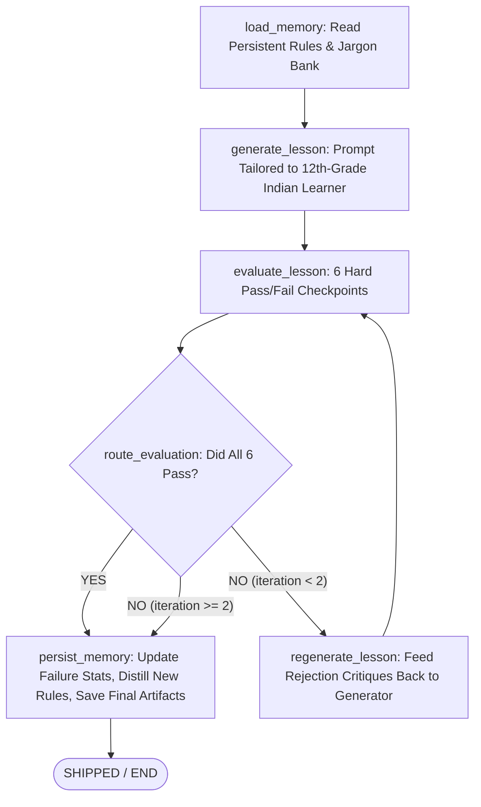

# 🚀 NextWave: Self-Evaluating Lesson Content Generator

> **Role Assessment:** GenAI Engineer - Content Systems  
> **Topic for Submission:** Introduction to RAG (Retrieval-Augmented Generation)  
> **Target Audience:** 12th-grade graduate from India, limited English vocabulary, non-English-medium background, eager to kickstart an AI career.

---

## 📌 Executive Summary

Modern AI content generation systems often fail because they rely on single-shot prompts without automated quality gates. In production educational systems, shipping unvetted content can permanently confuse beginner learners.

This project implements an **autonomous, self-evaluating agentic content loop** using **LangGraph** and **Python**. The system generates beginner-friendly pedagogical lessons, subjects them to a strict **6-dimension binary pass/fail rubric** (with zero partial credit), logs granular critiques on rejection, and automatically regenerates flawed drafts until they meet the shipping bar. Furthermore, the pipeline features a **persistent self-evolving memory** that tracks failure patterns across runs to dynamically sharpen system prompts and prevent recurring mistakes.

---

## 🏗️ System Architecture

The pipeline is modeled as a stateful Directed Acyclic Graph (DAG) state machine using **LangGraph**:

```
                       ┌─────────────────────────┐
                       │  Persistent Memory      │
                       │  (Load Distilled Rules) │
                       └────────────┬────────────┘
                                    │
                                    ▼
                       ┌─────────────────────────┐
                       │  Generator Agent        │
                       │  (Draft Generation)     │
                       └────────────┬────────────┘
                                    │
                                    ▼
                       ┌─────────────────────────┐
                       │  Evaluator Agent        │
                       │  (6 Hard Checkpoints)   │
                       └────────────┬────────────┘
                                    │
                                    ▼
                       ┌─────────────────────────┐
                       │  Conditional Router     │
                       └─────┬─────────────┬─────┘
                             │             │
                    [FAIL & Retries < 2]   [PASS or Retries == 2]
                             │             │
                             ▼             ▼
              ┌────────────────────────┐  ┌─────────────────────────┐
              │  Regenerator Agent     │  │  Persist & Evolve       │
              │  (Targeted Correction) │  │  (Save Outputs/Memory)  │
              └──────────────┬─────────┘  └────────────┬────────────┘
                             │                         │
                             └───────────┐             ▼
                                         │          [ END ]
                                         ▼
                            (Loop back to Evaluator)
```

### Architecture Diagram (Mermaid)



---

## 🎯 The 6-Checkpoint Hard Pass/Fail Rubric

Every draft is evaluated strictly with **binary boolean gates (`True` / `False`)**. There is **no partial credit**—if even one checkpoint fails, the lesson is rejected and fed into the regeneration cycle:

| # | Checkpoint Dimension | Criteria & Rationale | Failure Mode & Rejection Action |
|---|----------------------|----------------------|----------------------------------|
| **1** | `ACCURATE_AND_GROUNDED` | RAG mechanics must be factually correct. Explains external retrieval into context without claiming model weights are retrained. | Fails if claims RAG fine-tunes base weights or invents false facts. |
| **2** | `TEACHES_BY_EXAMPLE` | Must feature a relatable real-world analogy (e.g., **Open-Book vs Closed-Book Exam**) tailored for Indian 12th-graders, followed by a concrete step-by-step query walkthrough. | Fails if purely theoretical or abstract. |
| **3** | `COVERS_KEY_POINTS` | Must cover all 5 pillars: (1) RAG definition; (2) Hallucination & Knowledge Cutoff problem; (3) Retriever; (4) Generator; (5) End-to-end workflow. | Fails if any of the 5 pillars is missing. |
| **4** | `BEGINNER_FRIENDLY_LANGUAGE` | Simple, conversational vocabulary. Average sentence length must remain $\le 22$ words to support students from non-English medium backgrounds. | Fails if dense, academic, or complex Latinate vocabulary is detected. |
| **5** | `NO_UNEXPLAINED_JARGON` | Zero unexplained buzzwords. If terms like *LLM*, *Embeddings*, *Vector Database*, or *Hallucination* appear, they must be immediately defined in plain words. | Fails if technical terms are dropped without inline contextual explanation. |
| **6** | `COHERENT_TEACHING_FLOW` | Strict pedagogical progression: Hook $\rightarrow$ Analogy $\rightarrow$ Definition $\rightarrow$ Mechanics $\rightarrow$ Walkthrough $\rightarrow$ **3-Question Practice Quiz with Answers**. | Fails if disorganized or if the knowledge check quiz is omitted. |

---

## 🧠 Self-Evolving Memory & Dynamic Prompt Sharpening

The system does not start from zero on every run. It maintains persistent learning across sessions in `data/memory_store.json`:

1. **Failure Pattern Tracking:** Tracks failure frequencies per rubric checkpoint.
2. **Flagged Jargon Bank:** Automatically monitors high-risk terms (e.g. *latent space*, *vector embeddings*, *parametric memory*).
3. **Automated Rule Distillation:** When a checkpoint repeatedly fails across runs, the memory engine synthesizes a new **Evolved Rule**.
   - *Example synthesized rule:* `"EVOLVED RULE: Strictly forbid dropping acronyms (RAG, LLM, API) without inline bracket definitions on first mention."`
4. **Active Prompt Sharpening:** These distilled rules are dynamically prepended to future generator system prompts, ensuring the generator never repeats historical mistakes.

---

## ⚡ Key Engineering Decisions & Trade-Offs

### 1. Why LangGraph over Simple Linear Chains?
- **State Machine Determinism:** LangGraph treats execution as a state transition system where every draft, evaluation report, iteration counter, and rejection feedback is an immutable, auditable state.
- **Bounded Retry Guarantees:** Single-prompt loops or uncontrolled while loops risk infinite recursion or runaway token costs. LangGraph guarantees bounded termination ($N \le 2$ retries).

### 2. Why Strict Binary Pass/Fail Instead of Numerical Scores (e.g., 7.5/10)?
- In automated content evaluation, numerical scoring creates "fuzzy" gray zones where a lesson scoring 7/10 might pass while still dropping an unexplained jargon word that confuses a beginner student.
- Binary gates guarantee that high standards are non-negotiable across all pedagogical dimensions.

### 3. Dual-Mode LLM Engine (Live API + High-Fidelity Simulation)
- Supports live **Google Gemini 2.5 Flash** and **OpenAI GPT-4o-mini** when API keys are present in `.env`.
- Includes a built-in **High-Fidelity Simulation Engine** allowing full offline execution, continuous integration testing, and zero-setup demonstration without requiring the reviewer to pay or enter API keys.

---

## 💻 Quickstart & Setup

### 1. Prerequisites
- Python 3.10+ (tested on Python 3.13)
- Git

### 2. Installation
```bash
# Clone the repository
git clone https://github.com/your-username/NextWave.git
cd NextWave

# Install dependencies
pip install -r requirements.txt
```

### 3. Environment Configuration (Optional)
If you wish to use live LLMs, copy `.env.example` to `.env`:
```bash
copy .env.example .env
```
Add your API key (e.g. `GEMINI_API_KEY=...` or `OPENAI_API_KEY=...`). If left blank, the system automatically uses the High-Fidelity Simulation Engine.

---

## 🖥️ Running the Application

### Option A: Interactive Web Dashboard (Recommended for Video Demo)
Launch the modern glassmorphic dashboard:
```bash
python app.py
```
Open your browser to: **`http://127.0.0.1:5000`**

#### Dashboard Features:
- **Interactive State Visualizer:** Watch LangGraph DAG nodes pulse as execution moves from Memory $\rightarrow$ Generator $\rightarrow$ Evaluator $\rightarrow$ Router $\rightarrow$ Persist.
- **One-Click Deliberate Error Demo:** Click `"Demo Catch Deliberate Error"` to inject unexplained jargon, watch the Evaluator reject it, inspect the rejection audit trail, and observe the regenerated passing lesson!
- **Evaluator Rubric Inspector:** Real-time breakdown of all 6 checkpoints with Pass/Fail badges, critiques, and suggested guidance.
- **Persistent Memory Inspector:** Live stats on total runs, pass rate, active distilled rules, and flagged jargon bank.

---

### Option B: Terminal CLI Runner
You can run the full pipeline directly from the command line:

```bash
# 1. Clean run (expected to pass on iteration 1)
python run_pipeline.py --topic "Introduction to RAG"

# 2. Deliberate Error Injection (demonstrates Evaluator rejection & regeneration)
python run_pipeline.py --inject-error unexplained_jargon

# 3. Test other failure modes
python run_pipeline.py --inject-error missing_analogy
python run_pipeline.py --inject-error dense_academic
```

---

## 🧪 Test Suite

Run the comprehensive unit and integration test suite:
```bash
python -m unittest discover tests
```

### Tested Capabilities:
- `test_clean_lesson_passes_all_checkpoints`: Confirms ground truth lesson passes 6/6 checkpoints.
- `test_deliberate_jargon_is_caught_and_fails`: Confirms evaluator flags unexplained jargon and rejects draft.
- `test_missing_analogy_fails`: Confirms evaluator fails `TEACHES_BY_EXAMPLE` when analogy is omitted.
- `test_dense_academic_language_fails`: Confirms evaluator fails `BEGINNER_FRIENDLY_LANGUAGE`.
- `test_bounded_loop_termination`: Confirms pipeline terminates safely without infinite loops.
- `test_evolution_triggers_on_repeated_rejection`: Confirms persistent memory synthesizes new rules upon repeated failure.

---

## 📁 Repository Structure

```
NextWave/
├── app.py                      # Interactive Web Dashboard (Flask + REST API)
├── run_pipeline.py             # CLI runner with rich console outputs
├── pipeline/
│   ├── __init__.py             # Pipeline package exports
│   ├── graph.py                # LangGraph StateGraph orchestrator
│   ├── state.py                # Pipeline state definitions
│   ├── rubric.py               # 6 hard pass/fail checkpoints & Pydantic schemas
│   ├── evaluator.py            # Hybrid Evaluator Agent (heuristics + semantic validation)
│   ├── generator.py            # Generator Agent with audience persona & retry correction
│   ├── memory.py               # Persistent Memory & Self-Evolving Engine
│   └── llm_factory.py          # Multi-model provider (Gemini, OpenAI, Simulation)
├── templates/
│   └── index.html              # Sleek dark-mode dashboard with real-time DAG visualizer
├── static/
│   ├── css/style.css           # Glassmorphism styling & animations
│   └── js/app.js               # Client controller for live pipeline interaction
├── tests/
│   ├── test_evaluator.py       # Unit tests for evaluator error detection
│   ├── test_pipeline.py        # Integration tests for LangGraph state machine
│   └── test_memory.py          # Unit tests for persistent memory evolution
├── data/
│   ├── memory_store.json       # Persistent memory store across runs
│   └── outputs/
│       ├── rag_lesson_final.md # Generated passing lesson
│       └── rag_rejection_log.json # Rejection audit trail
├── requirements.txt            # Python dependencies
├── .env.example                # Example environment variables
├── SUBMISSION_DOCUMENT.md      # Comprehensive Google Doc / Notion submission artifact
└── LOOM_WALKTHROUGH_SCRIPT.md  # 15-20 min video presentation walkthrough & script
```

---

## 🎥 Video Demonstration & Submission Artifacts

- **Submission Document:** [SUBMISSION_DOCUMENT.md](file:///c:/Users/kchak/NextWave/SUBMISSION_DOCUMENT.md)
- **Loom Walkthrough Script:** [LOOM_WALKTHROUGH_SCRIPT.md](file:///c:/Users/kchak/NextWave/LOOM_WALKTHROUGH_SCRIPT.md)
- **Final Generated Lesson:** [data/outputs/rag_lesson_final.md](file:///c:/Users/kchak/NextWave/data/outputs/rag_lesson_final.md)
- **Rejection Audit Log:** [data/outputs/rag_rejection_log.json](file:///c:/Users/kchak/NextWave/data/outputs/rag_rejection_log.json)
